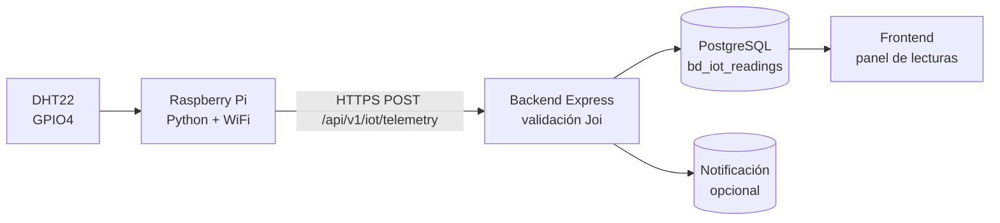

# Prototipo IoT propuesto — Raspberry Pi + DHT22

> **Estado: propuesta de diseño (bonificación).** No hay dispositivo, firmware ni endpoint desplegado en este proyecto. Este documento describe cómo se integraría sin afectar la billetera, las órdenes ni la verificación de identidad.

## 1. Objetivo

Capturar lecturas ambientales con un sensor **DHT22** conectado a una **Raspberry Pi** y enviarlas al backend de BANCA NEN para su almacenamiento y consulta posterior. La bonificación se cumple al documentar el prototipo, el protocolo y el recorrido de los datos hasta el sistema.

**Restricción importante:** el prototipo solo lecturas ambientales. **No captura tráfico de red, direcciones MAC, IPs de dispositivos ni información personal.** No controla actuadores ni mueve saldos.

## 2. Componentes

| Componente | Función | Tecnología |
| --- | --- | --- |
| Sensor DHT22 | Mide temperatura y humedad relativa | Salida digital única por GPIO |
| Raspberry Pi 3/4 | Lee el sensor, arma el mensaje y lo envía | Python 3 + `Adafruit_DHT` o `board` |
| Red | Transporte de la lectura | WiFi → HTTPS |
| Backend BANCA NEN | Valida, guarda y expone la lectura | Express + TypeORM + PostgreSQL |
| Panel (opcional) | Visualización de últimas lecturas | React + Vite |



## 3. Protocolo de comunicación

**Transporte:** HTTPS sobre WiFi, petición `POST` cada **30 segundos**. Se prefiere HTTPS antes que MQTT porque el backend ya expone REST y no requiere un bróker adicional.

### 3.1 Petición

```http
POST /api/v1/iot/telemetry HTTP/1.1
Host: banca-nen.localhost
Content-Type: application/json
Authorization: Bearer <token-de-dispositivo>
X-Device-Sequence: 1420

{
  "deviceId": "nen-pi-01",
  "temperature": 23.4,
  "humidity": 61.2,
  "timestamp": "2026-11-27T11:00:00Z"
}
```

| Campo | Tipo | Regla |
| --- | --- | --- |
| `deviceId` | string | Identificador opaco del dispositivo; no es una MAC ni un correo. |
| `temperature` | number | Grados Celsius, rango `-40 … 80`. |
| `humidity` | number | Porcentaje, rango `0 … 100`. |
| `timestamp` | string | ISO 8601 UTC generado por la Raspberry Pi. |
| `X-Device-Sequence` | entero | Monótono por dispositivo; evita duplicados por reintentos. |

### 3.2 Respuesta

```json
{
  "status": "success",
  "data": {
    "id": "0f1c…",
    "deviceId": "nen-pi-01",
    "acceptedAt": "2026-11-27T11:00:01.240Z"
  }
}
```

| Código | Significado |
| --- | --- |
| `201` | Lectura aceptada y persistida. |
| `400` | Cuerpo inválido o fuera de rango. |
| `401` | Token de dispositivo ausente o vencido. |
| `409` | Secuencia ya registrada para ese dispositivo (reintento). |
| `429` | Límite de frecuencia excedido. |
| `503` | Base de datos no disponible; el dispositivo reintenta con *backoff*. |

## 4. Seguridad y privacidad

- Token de dispositivo con **alcance único `iot:telemetry`**; nunca comparte permisos con el usuario ni con el administrador.
- `deviceId` opaco y rotatable; **no se envían MAC, IP del sensor ni datos de personas**.
- TLS obligatorio; el token no se registra en logs ni en la auditoría de usuario.
- *Rate limit* por dispositivo: una lectura cada 30 s con tolerancia de reintentos.
- La lectura no se envía a Gemini ni a ningún proveedor externo.
- El sensor es **solo de lectura**: no hay endpoints para actuadores.

## 5. Integración en el backend (cambios necesarios)

No implementados actualmente; serían los puntos de enganche:

| Capa | Archivo propuesto | Responsabilidad |
| --- | --- | --- |
| Modelo | `src/models/IoTReading.ts` | Entidad `iot_readings` con `deviceId`, `temperature`, `humidity`, `recordedAt`, `sequence`. |
| Migración | `src/migrations/*IotReadings*` | Crear tabla, índice único `(device_id, sequence)` e índice por `recorded_at`. |
| Validador | `src/validators/iot.validator.ts` | Joi con rangos y formato ISO. |
| Servicio | `src/services/iot.service.ts` | Persistir, detectar duplicados y exponer últimas lecturas. |
| Controlador/Ruta | `src/controllers/iot.controller.ts`, `src/routes/iot.routes.ts` | `POST /iot/telemetry`, `GET /iot/readings?deviceId=…`. |
| Panel | `frontend/src/pages/iot/IotPanel.tsx` | Últimas lecturas y estado del dispositivo. |

## 6. Criterios de aceptación

1. La Raspberry Pi publica una lectura válida cada 30 s por HTTPS.
2. El backend responde `201` y la lectura queda en PostgreSQL.
3. Un reintento con la misma secuencia responde `409` y no duplica filas.
4. Un token sin alcance `iot:telemetry` responde `401`.
5. La información aparece en el panel sin exponer identidad de persona ni de red.
6. Ninguna lectura modifica saldos, órdenes ni estados KYC.

## 7. Pruebas del prototipo

- **Unitario:** validador Joi con valores límite (`-40`, `80`, `0`, `100`).
- **Integración:** `POST /iot/telemetry` contra `banca_nen_test`, incluyendo duplicado por secuencia.
- **Dispositivo simulado:** script Python que envía dos lecturas y comprueba `201` y `409`.
- **Hardware:** lectura real del DHT22 en GPIO4 y verificación en el panel.
